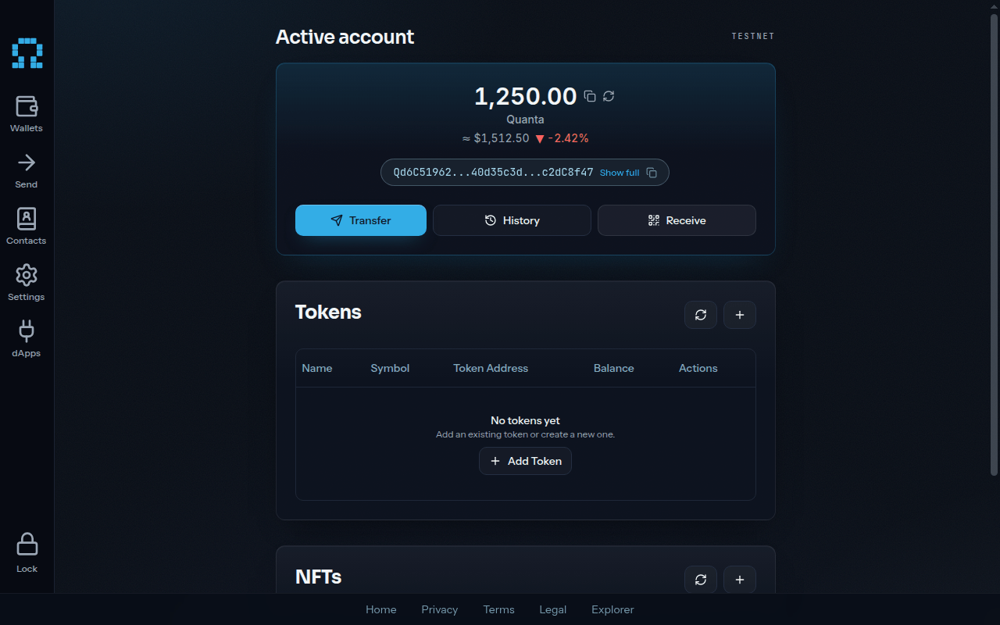
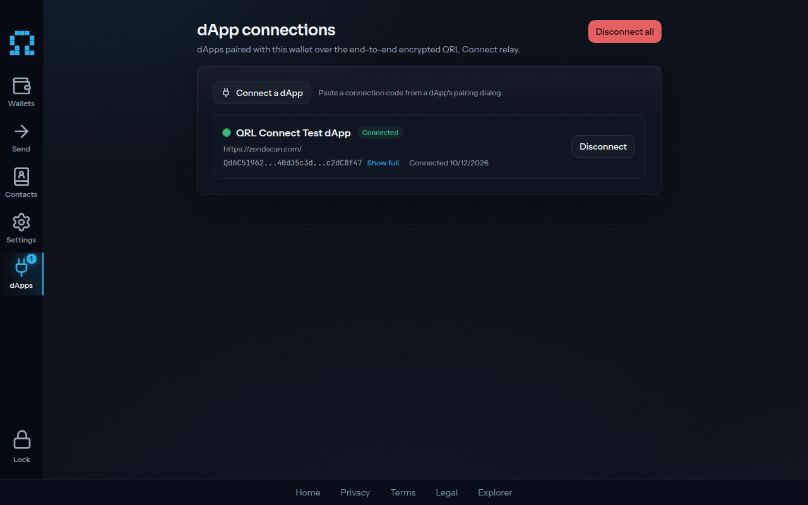
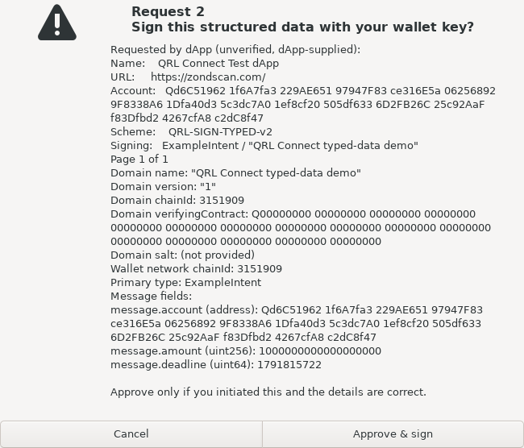
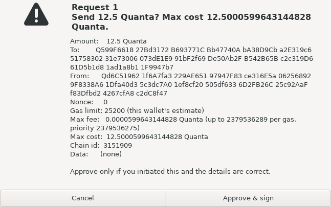
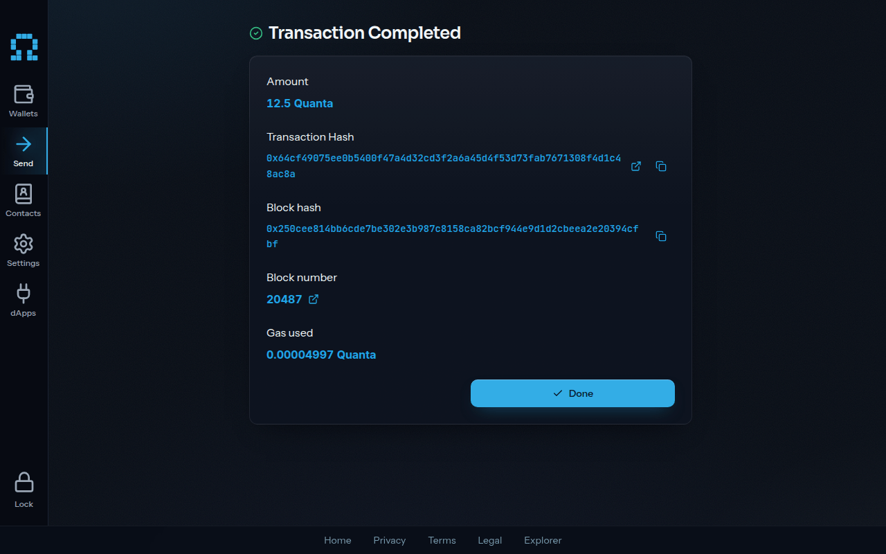
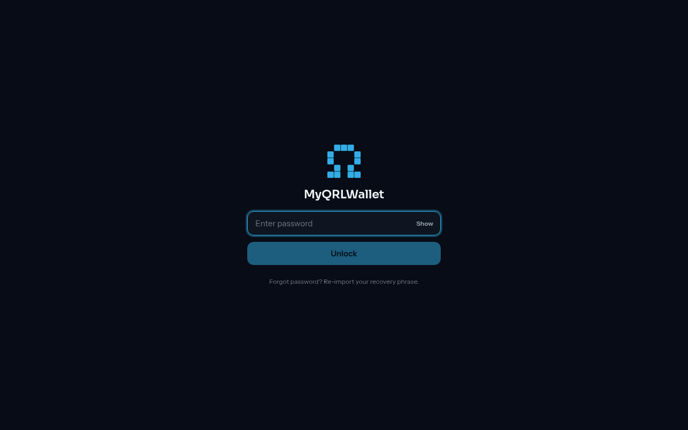

# MyQRLWallet Desktop

Post-quantum, self-custody QRL desktop wallet. An Electron shell built around a
hardened four-process architecture: a sandboxed renderer (the real
`myqrlwallet-frontend` React app, reused as-is), a broker main process, and an
isolated signer `utilityProcess` that holds the decrypted keys and signs.

Once an account exists, the signer holds decrypted keys and performs signing.
During account setup, the renderer shows a new account's recovery phrase once
for backup. Import forms read typed recovery phrases and hex seeds, and encrypted
wallet files are decrypted in the renderer or its worker. Main brokers these
secrets between the renderer and the signer. A compromised renderer during setup
or import can recover that account.

The design rationale and future proposals are in
[`docs/ARCHITECTURE_RESEARCH.md`](docs/ARCHITECTURE_RESEARCH.md). This README
describes the implemented behavior and how to run/build it. The honest
security tradeoffs are in [`THREAT_MODEL.md`](THREAT_MODEL.md) and the
renderer-hardening checklist as-built is in [`SECURITY.md`](SECURITY.md).

## At a glance

- **Stack:** Electron 44 (locked to 44.9.3; bundled Node 24.22.0 + Chromium 152.0.7977.167) + electron-vite 5 + electron-builder 26 (GA), TypeScript (strict). The renderer is the real `myqrlwallet-frontend` (React 19), built unchanged. See the [Electron 44 upgrade review](docs/ELECTRON_44_UPGRADE.md) and [1.4.3 security notes](CHANGELOG.md#143---2026-10-22).
- **Renderer reuse:** the web wallet is the desktop UI, with no fork. It is built with `VITE_DESKTOP=1` and loaded over `file://`; the few desktop adaptations are runtime-gated and web-safe (see "Renderer reuse" below). A frontend update is just a rebuild.
- **Key isolation:** the signer generates accounts, encrypts the desktop wallet envelopes, and decrypts keys for unlock and signing. Setup and import expose recovery material to the renderer and main as described above. The desktop bridge routes signing to the signer; in-page PIN storage and signing entry points throw as defense-in-depth. Encrypted-wallet-file decryption remains enabled in the renderer.
- **Post-quantum signing:** Halborn-audited `@theqrl/mldsa87` (ML-DSA-87 / FIPS 204, NIST Level 5), run ONLY inside the signer process.
- **Key at rest:** Argon2id (`@node-rs/argon2`) password-derived KEK + AES-256-GCM, with the macOS Keychain (Designated Requirement + Touch ID) as defense-in-depth. No PIN: the desktop unlock secret is a password.
- **Environment:** production build by default. The bundled renderer targets `qrlwallet.com`; export `VITE_NODE_ENV=development` plus the dev vars for a staging (`dev.qrlwallet.com`) build. Repoint with env vars (see "Renderer reuse").

## Download

Prebuilt installers are on the [Releases](https://github.com/DigitalGuards/myqrlwallet-desktop/releases/latest)
page: a Windows NSIS installer (`.exe`, x64/arm64), a universal Linux
`AppImage`, a Debian/Ubuntu `.deb`, and a Fedora/RHEL `.rpm`. Each release
lists SHA-256 checksums.

These binaries are currently **unsigned**: Windows SmartScreen warns on first
launch ("More info -> Run anyway"), and the Linux AppImage needs `chmod +x`
before running. Code-signing (Authenticode) and macOS notarization are a planned
follow-up; there is no macOS build yet. Builds target production
(`qrlwallet.com`); see "Pointing at an environment" to repoint.

To build the installers yourself, see "Packaging and signing" below.

### Version 1.1: QRL v3 accounts

This release uses QIP-55 addresses: uppercase `Q` followed by 128 hexadecimal
characters. It targets the v3 test network and checks its chain ID and
genesis before account RPC calls and transaction broadcasts.

V3 wallets and settings use a separate `v3-private` data directory. Earlier
encrypted wallet files and browser state remain available to Desktop v1.0.0.
Import your recovery phrase or extended seed to use its v3 account. If you need
an earlier wallet backup, open v1.0.0 and export it there before importing it.
Earlier testnet balances do not carry over to v3.

Version 1.1.1 refreshes the shared renderer for Connect 5 relay pairing and
explicit transaction chain IDs. Upgrade from 1.1.0 before using connected dApps.


## Screenshots

| | |
|---|---|
|  |  |
| Wallet home (testnet) | dApps paired over QRL Connect |
|  |  |
| A dApp's typed-data request in the trusted confirmation, drawn by the main process outside the renderer | Send confirmation with the full recipient, fee cap and chain ID |
|  |  |
| Send result with the transaction hash and block | Native unlock window |

The confirmation dialogs are OS-native message boxes, shown here as drawn on Linux. Windows draws them in its own style.

Transaction reviews paginate using the parent display's Electron DIP work area.
The conservative allowance uses 24 px detail lines, 29 px bold heading lines,
76 px chrome and a 48 px vertical margin, measured at DejaVu Sans 12 pt / 125%
text. Every page reserves the request label, wrapped heading and approval note:
an ordinary two-line heading leaves 20 body lines at 1024x768 and 18 at 1280x720.
The heading width uses 20 DIP per column with 96 DIP horizontal slack, capped
at 46 display columns in both work areas because GTK adds word wraps to wider
headings even when the work area could fit them. Overwide headings gain only line breaks,
preserving the complete amount and max cost. Transactions within this
conservative allowance keep their exact 1.4.3 single-page rendering and buttons.
Longer reviews paginate even if a smaller font could fit them. Complete rows
stay together whenever they fit a page; taller rows continue between their
existing wrapped lines with the row label and ` (continued)` on each
continuation page. All original lines stay in order, with the origin block at
the end. Only the final page offers approval, and Cancel stays the default.

The qualified guarantee is that **every transaction page of the corpus fits
horizontally and vertically, with every line and both buttons visible**, on
Linux GTK 3 under Xvfb at 1024x768 and 1280x720 work areas, DejaVu Sans 8 to 12 pt
at 100% and 125% text. This includes the 80-digit heading, invisible URL, gas
warning and `40 18 1 0` fixtures. The floor is four body lines and 24 heading
columns; even when that floor exceeds a tiny work area, the dialog is shown as
in 1.4.3. Transactions have no page cap or new display-size rejection. Display
changes during review abort it and require a fresh request; the one-at-a-time
gate and arming delay remain unchanged. Message and typed-data summaries are
unchanged. Outside the qualified band (including larger fonts, higher text
scaling, smaller screens and unqualified Windows/macOS geometry), a page can
still overflow as in 1.4.3; its buttons then leave the screen and Enter cancels.
An app-drawn confirmation window is the proposed long-term fix, with the owner
decision pending. See [the layout budget](THREAT_MODEL.md#transaction-pages-and-qualified-visibility).

## Prerequisites

- Electron 44 supports 64-bit platforms. macOS builds require macOS 13 (Ventura)
  or later; Windows ia32 and Linux armv7l are unsupported.
- Node `>=22.13.0` for the dev toolchain. The repo pins `22` (current LTS) in
  `.nvmrc`; run `nvm use`. (The packaged app runs on Electron's own bundled Node,
  currently 24.22.0; this floor is only for building, testing, and packaging locally.)
  `@types/node` stays at `^22` to enforce that development API floor.
- A sibling `../myqrlwallet-frontend` checkout. The renderer is built FROM that
  directory (never vendored into this repo), so the desktop and frontend repos
  sit side by side, both as submodules of the parent workspace. Initialise it
  with `git submodule update --init ../myqrlwallet-frontend` if absent.
- A C/C++ toolchain is NOT required: `@node-rs/argon2` and `@theqrl/*` are
  pure-NAPI / pure-JS. NAPI is ABI-stable across Node and Electron, so there is
  no `electron-rebuild` step.

## Quick start

```bash
nvm use                         # Node 22 LTS (.nvmrc)
npm install                     # legacy-peer-deps is preconfigured
npm run build:renderer:frontend # build the real frontend into out/renderer
npm run dev                     # launch the hardened shell against it
```

`npm run dev` builds main + preload in watch mode and launches Electron; it
loads the renderer from `out/renderer/index.html`. Build the renderer once first
(the command above) or the window is blank. For live frontend HMR, run the
frontend's own dev server and point the shell at it:

```bash
# in ../myqrlwallet-frontend:
VITE_DESKTOP=1 npm run dev      # e.g. http://localhost:5173
# in this repo:
QRL_RENDERER_DEV_URL=http://localhost:5173 npm run dev
```

Production ALWAYS uses `loadFile` over `file://`, never a remote URL; the dev
URL path is gated on `!app.isPackaged`.

## What works today

The supported flows have the following process boundaries:

- **Create a wallet:** the signer generates the seed and encrypts the desktop
  wallet envelopes; main persists them. The recovery phrase passes through main
  to the renderer, which shows it once for backup. This phrase can recover the
  account and is exposed to a renderer compromised during setup.
- **Import a wallet:** from a recovery phrase, a raw 51-byte hex extended seed,
  or an encrypted wallet file. The recovery phrase and hex seed encode the same
  key; the signer reconstructs the canonical recovery phrase from a hex seed.
  Import forms read typed recovery phrases and hex seeds, and
  encrypted wallet files are decrypted in the renderer or its worker. Main
  brokers the recovered secrets to the signer, which derives the account and
  encrypts the desktop wallet envelopes for main to persist. A compromised
  renderer during import can recover that account.
- **Multiple wallets:** the renderer blocks imports at ten accounts. Remove
  an existing account before importing another. Each account is encrypted under
  its own password (one envelope per address at
  `userData/wallet/seeds/<address>.json`, plus an `active.json` pointer). Add,
  switch, and remove accounts individually. The signer holds at most one unlocked
  session at a time, so switching to another account requires unlocking it (the
  isolation tradeoff, see [`THREAT_MODEL.md`](THREAT_MODEL.md)). A legacy
  single-wallet `seed.json` migrates into this layout once at boot.
- **Unlock / lock:** a separate app-owned native unlock window (`src/unlock/`)
  collects the password; it shows an account picker when more than
  one wallet exists. Password unlock (Argon2id KEK), macOS Touch-ID / keychain
  unlock, and a sliding auto-lock that zeroizes and notifies the renderer.
  The genuine input stays isolated from the wallet renderer. A compromised
  renderer can still draw a lookalike prompt and read input supplied to it;
  see the [unlock cues and phishing limits](THREAT_MODEL.md#b-renderer-remote-code-execution-renderer-rce).
- **Remove a wallet:** deletes one account's encrypted seed and clears its
  keychain entry, ONLY after a trusted main-drawn confirmation that names the
  address; other accounts are untouched.
- **Balance + assembly:** balance reads and unsigned type-2 (EIP-1559)
  transaction assembly via the bundled RPC proxy.
- **Sign + broadcast:** native transfers, QRC20 token transfers, token creation,
  and NFT transfers, plus dApp-connect `qrl_sendTransaction` /
  `qrl_signTransaction` / `qrl_signMessage` / `qrl_signTypedData`. Each signature is gated by the trusted
  main-drawn confirmation modal and is byte-faithful to the web wallet, so
  signatures verify identically. The wallet checks its network over RPC before
  signing, and the confirmed transaction chain ID is exactly the one signed.

Typed-data signing supports QRL-SIGN-TYPED v1 and v2 with byte-identical web
wallet and Connect SDK digests. An address field, including an address array or
a domain verifying contract, selects v2's 64-byte value slots. Address-free
payloads retain v1. The trusted dialog shows dApp provenance, scheme, domain,
primary type and every message field once across sequential pages, with bounded
string/byte previews and a warning when the domain chain ID differs from the
wallet's configured network. Approval is available only on the last page, and
reviews above 10 pages are refused. Message signing receives the same complete
paginated review: every byte appears once as escaped text or full hex, with a
visible `| ` gutter on every body row. Main validates every resource bound
before confirmation; the signer checks them again and binds the request to its
unlocked account. Message and typed-data signing first call `assertNetworkReady`,
which checks `qrl_chainId` and genesis over RPC; signing is refused while RPC is
unavailable, including typed data without a domain chain ID. Typed data with a
domain chain ID also waits for a successful RPC lookup to compare it with the
wallet chain. Approval stays disabled while that lookup is pending or failed;
a domain mismatch is shown as a warning.

## Native languages

Desktop-owned unlock and settings windows, custom application menu items, and
wallet-owned error and startup notices use five static catalogs bundled with
the app: English (`en`), German (`de`), Spanish (`es`), Russian (`ru`) and
Simplified Chinese (`zh-CN`). Native translation uses no network. Platform menu
roles, including About and Quit, retain their OS-provided behavior and
localization. Quanta, QRL, QRL 2.0 and MyQRLWallet retain their names.

Trusted transaction, message, typed-data and Remove wallet confirmations remain
English in every language for now. Their text, pagination and approval behavior
are unchanged. Translating these confirmations is deferred to a separate change
after the page-visibility fix.

At each startup, before the renderer reports its choice, main uses the first
supported `app.getPreferredSystemLanguages()` entry, with `app.getLocale()` when
the preferred list is empty. Regional English/German/Spanish/Russian codes map
to their base code. `zh-CN`, `zh-SG` and `zh-Hans-*` map to `zh-CN`; unspecified
and Traditional Chinese fall back to English. Unsupported lists use English.

A renderer that supports languages calls the optional
`window.qrlWallet.setLanguage(language)` at startup and after each language
change; the web wallet adds this call in its language release, so builds with
an earlier renderer keep the system language. It returns `Promise<void>` after the
choice is saved in the versioned settings store and applied. Feature-detect the
method when supporting earlier desktop versions. This method only selects one
of the five static catalogs. Objects, regional variants and additional label
data are rejected at this bridge. Security preferences remain native-owned.

Unlock and settings update in place, including displayed wallet-owned errors,
without losing form input. Custom menu items update immediately. External error
details retain their original text. Language changes leave open and arming
trusted confirmations unchanged.

`src/shared/locales/` holds the static catalogs. Key/placeholder parity, regional
resolution, settings persistence and real IPC sender/schema rejection are
covered by `npm test`. The headless native window probe uses the pinned
frontend's Playwright installation and requires Xvfb and ImageMagick. After
`npm run build`, run:

```bash
env -u DISPLAY -u WAYLAND_DISPLAY xvfb-run -a -s '-screen 0 1600x1100x24 -nolisten tcp' npm run test:e2e:i18n
```

It checks German and Chinese unlock and settings windows, live menu translation,
and verbatim external settings errors with disposable profiles and an offline
synthetic wallet. Screenshots and results go to a temporary directory,
configurable with `QRL_I18N_EVIDENCE`. No installer is needed.

## Architecture: four processes, one trust gradient

Trust runs lowest to highest. Setup and import recovery material crosses these
boundaries; ordinary desktop unlock and signing decrypt keys in the signer.

| Process | Trust | Has Node? | Holds keys? | Responsibility |
|---|---|---|---|---|
| Renderer | Lowest (treated as fully untrusted) | No (`sandbox: true`, `nodeIntegration: false`) | Recovery material during setup/import | Shows a new account's recovery phrase once for backup; import forms read typed recovery phrases and hex seeds, and decrypt encrypted wallet files in the renderer or its worker. Routes desktop signing through `window.qrlWallet`. A compromised renderer during setup or import can recover that account. |
| Preload | Bridge | No (tiny allowlist) | Recovery material transits the bridge | Mounts the narrow `window.qrlWallet` API over `contextBridge`, including setup/import arguments and responses. No raw `ipcRenderer`, no `require`. |
| Main (broker) | Mid | Yes | Setup/import recovery material and keychain KEKs in transit | Brokers recovery material between renderer and signer, and KEKs between signer and OS keychain. Owns window lifecycle, IPC sender + schema validation, trusted confirmations, RPC and encrypted wallet files on disk. |
| Signer (`utilityProcess`) | Highest, most isolated | Yes | Decrypted keys per operation; KEK while unlocked | Generates accounts, encrypts desktop wallet envelopes, decrypts keys for unlock/signing, signs and wipes secret buffers. Speaks only to main over `parentPort`; the renderer has no direct handle to it. |

Signing requests require a specific payload and trusted user confirmation.
The renderer has no direct signer handle or unrestricted filesystem API.
`connect-src` restricts the request types it governs to the configured origins.
`img-src 'self' data: https://<SERVER_HOST>` permits local/data images and the
configured backend's artwork/IPFS gateway. Other NFT and token artwork uses a
placeholder. `worker-src 'self'` permits bundled worker files and blocks blob
workers. The pinned frontend needs no explorer images or public IPFS fallback.
Allowed service requests, external-browser links, explicit resource hints and
WebRTC TCP/proxy paths remain possible outbound channels. Automatic DNS
prefetch and direct WebRTC UDP receive additional restrictions. See the
[request inventory](docs/RENDERER_CSP_INVENTORY.md) and
[remaining channels](SECURITY.md#remaining-outbound-channels).

### Data flow for a spend

1. Renderer calls `window.qrlWallet.requestSignature({ kind: 'transaction', tx })`.
2. Preload forwards it on the `wallet:requestSignature` IPC channel.
3. Main validates the sender (top frame, `file:` origin) and zod-parses the payload.
4. Main draws a trusted confirmation modal ("you are signing X to Y"). The renderer cannot alter that native modal or bypass its approval gate.
5. On approval, main asks the signer to sign. The signer unwraps the seed, signs with `@theqrl/mldsa87`, zeroizes, and returns the raw signed tx.
6. Renderer broadcasts it via `window.qrlWallet.sendRawTransaction`.

## Renderer reuse: the web wallet IS the desktop UI

The renderer is not a fork or a port: it is the real `myqrlwallet-frontend`,
built by its own toolchain via `scripts/build-renderer.sh` into `out/renderer`
(run by `npm run build`). The frontend source is never copied into this repo, so
it cannot drift. Updating the desktop UI is just rebuilding the current frontend
checkout.

It needs only a handful of adaptations, all web-safe and runtime-gated by
`isDesktop = Boolean(window.qrlWallet)` so the web build is byte-identical:

- **Asset base** `VITE_DESKTOP=1` -> Vite `base: './'` for `file://`.
- **Routing** `createBrowserRouter` -> `createHashRouter`, switched at runtime
  when `window.qrlWallet` is present (no build flag, no HTML surgery).
- **Key ops** desktop account generation, envelope encryption, unlock and
  signing delegate through the native bridges. In-page PIN storage and signing
  entry points throw. Setup displays recovery phrases and import reads recovery
  material, including renderer-side encrypted-wallet-file decryption.
- **No PIN** the desktop unlock secret is a password; PIN UI is hidden under
  desktop and unlock prompts are replaced by the signer session.

Two main-process shims keep the unmodified web bundle working under `file://`:
a `protocol.handle('file')` handler (`installFileProtocolHandler`) remaps the
frontend's root-absolute asset paths (logo, `/tree.svg`), attaches the strict
CSP as a real response header (`webRequest` does not reliably fire for `file://`
document loads), and contains every served path to the app bundle so a
compromised renderer cannot read arbitrary host files; and
`app.userAgentFallback` strips the `MyQRLWallet` / `Electron` tokens so the
frontend runs as the desktop/web build, not its mobile webview.

### Pointing at an environment

This build targets production (`qrlwallet.com`) by default. The frontend
selects its backend / RPC / explorer from `VITE_NODE_ENV` + `VITE_*_DEVELOPMENT`
/ `_PRODUCTION` (frontend `src/config/networks.ts`). `build-renderer.sh`
defaults those to production; each is overridable from the environment, so a
staging build just exports `VITE_NODE_ENV=development` and the `*_DEVELOPMENT`
vars before building. The main-process CSP `connect-src` allowlist
(`src/main/config.ts` `frontendOrigins`) is kept in sync with those origins;
override it with `QRL_FRONTEND_ORIGINS` (space-separated) when repointing.
All endpoints must serve the pinned v3 chain ID and genesis. Endpoint overrides
select another provider for that same network.

## Directory map

```
myqrlwallet-desktop/
  src/
    shared/        Cross-process pure data + types (no side effects):
                     constants.ts  IPC channels, EVENTS, BRIDGE_KEY, MLDSA87
                                    sizes, KDF_DEFAULTS, SCHEME tags, AEAD
                     schemas.ts    zod schemas + inferred request/result types
                     bridge.ts     QrlWalletApi + window.qrlWallet augmentation
                     protocol.ts   private main <-> signer message shapes
    preload/       contextBridge mount of window.qrlWallet (CJS, sandboxed)
    main/          Broker: index.ts (entry + file-protocol handler: CSP header,
                     asset remap, app-bundle containment + UA fix), ipc.ts
                     (handlers, incl. multi-wallet list/setActive/remove),
                     security.ts (CSP, sender validation, navigation lockdown),
                     permissions.ts (deny-by-default renderer permissions),
                     externalLinks.ts (trusted-host allowlist for openExternal),
                     config.ts (RPC + frontend origins, autolock), confirm.ts
                     (trusted modal), rpc.ts (proxy), seedFile.ts (multi-wallet
                     encrypted seeds at rest), unlockWindow.ts (native unlock
                     window + IPC), signerBridge.ts (fork + request/response)
    unlock/        Native, app-owned unlock window (its own small React renderer
                     + preload, built to out/unlock): index.html, main.tsx,
                     preload.ts, unlock.css
    signer/        Isolated highest-trust process: index.ts (entry, incl. the
                     create/import/unlock/sign/lock verbs), kdf.ts (Argon2id),
                     aead.ts (AES-256-GCM), signing.ts (ML-DSA-87 + web3 tx
                     signing + mnemonic generation), session.ts (in-memory
                     unlock + autolock), zeroize.ts (buffer wipe)
    keyvault/      OS app-binding (defense-in-depth): macKeychainVault.ts
                     (Touch ID, DR-bound), safeStorageVault.ts (DPAPI/libsecret,
                     no presence gate), nullVault.ts (password every unlock),
                     factory.ts (selects strongest available)
  native/macos-keychain/   Swift keychain helper source + build.sh
  resources/               Built helper lands here, copied into the .app bundle
  scripts/                 build-renderer.sh (builds the real frontend),
                             packaging hooks (afterPack/notarize/pgp-sign),
                             calibrate-kdf.ts
  test/                    node --test suites (see Testing)
  docs/                    ARCHITECTURE_RESEARCH.md, FRONTEND_INTEGRATION.md
  electron.vite.config.ts  Builds main + preload only (renderer is the frontend)
  electron-builder.yml     Packaging + signing config (electron-builder 26.x)
```

## Build

```bash
npm run build        # electron-vite build (main + preload) + build-renderer.sh
```

`npm run build:shell` builds only main + preload; `npm run build:renderer:frontend`
builds only the frontend into `out/renderer`. Preview the bundle with
`npm run preview`.

For an isolated worktree, set `QRL_FRONTEND_DIR` to a disposable copy of the
frontend source. The build installs its locked dependencies and builds it there,
then stages the output into this desktop checkout.

For Desktop 1.4.4, use frontend main revision
`683d0642f2b91b9e70c61e56989bddc4ff4b1ab0`, the web wallet released on 2026-10-24.
CI pins that same revision for this release. It includes the five wallet
languages, dApp approval visibility gate, typed-data chain check and frontend
zod fix. See the [1.4.4 release notes](CHANGELOG.md#144---2026-10-24).

## Packaging and signing

Build the platform installer with electron-builder (26.x GA). Each target runs
the build first, then `electron-builder`:

```bash
npm run dist:mac     # dmg + zip, arm64 + x64
npm run dist:win     # nsis, x64 + arm64
npm run dist:linux   # AppImage + deb + rpm, x64
```

`@node-rs/argon2` ships per-architecture prebuilds. The `predist:win` hook
installs the matching x64 and arm64 Windows bindings when packaging from Linux;
verify both bindings are included in their respective packages. The Linux `rpm`
target additionally needs `rpmbuild` on PATH; without it, `AppImage` + `deb`
still build.

macOS builds additionally need the signed keychain helper. Build it before
`dist:mac` or the app falls back to password-only unlock:

```bash
npm run build:keychain-helper   # native/macos-keychain/build.sh -> resources/qrl-keychain-helper
```

### Environment each signing step needs

Signing is wired through three electron-builder hooks (declared in
`electron-builder.yml`). Each reads its credentials from the environment; nothing
is committed.

| Step | Hook | Env required |
|---|---|---|
| macOS notarization | `afterSign` -> `scripts/notarize.cjs` | `APPLE_API_KEY` (path to the `.p8`), `APPLE_API_KEY_ID`, `APPLE_API_ISSUER`, and `APPLE_TEAM_ID`. The `.app` is signed from the login keychain identity (`CSC_NAME`); notarytool staples the ticket. |
| Windows Authenticode | `signtoolOptions` in `electron-builder.yml` | `WIN_CSC_LINK` (path or base64 of the `.pfx`) and `WIN_CSC_KEY_PASSWORD`. For EV / cloud-HSM certs, use a custom `signtoolOptions.sign` hook instead. |
| PGP detached signatures | `afterAllArtifactBuild` -> `scripts/pgp-sign.cjs` | `GPG_KEY_ID` (the key to detach-sign each artifact, producing `.asc` sidecars, as Railway Wallet does). |

`@electron/fuses` are flipped on the packaged binary in `afterPack` (before
signing). Verify the result on a built app with `npm run fuses:read`.

## Security model at a glance

- The password-derived Argon2id KEK protects stolen AES-256-GCM wallet envelopes
  when the attacker lacks the KEK. Whoever obtains the KEK can decrypt both
  recovery envelopes without knowing or cracking the password.
- OS keychain storage protects access to a saved KEK according to its platform
  policy: macOS Designated Requirement + user presence, or opt-in Windows/Linux
  `safeStorage`. It adds an access control around the saved KEK. It provides no
  additional password barrier after that KEK is recovered, including from main
  during provisioning or keychain unlock.
- The renderer is sandboxed and handles recovery material during setup/import
  as described above. Containment controls:
  `contextIsolation`, `sandbox`, `nodeIntegration: false`, a strict CSP
  (`default-src 'self'`, `script-src 'self' 'wasm-unsafe-eval'` with no
  inline/eval of JS) delivered as a
  real `file://` response header, the file handler contained to the app bundle,
  IPC sender + schema validation, navigation lockdown with a trusted-host
  allowlist for external links, deny-by-default renderer permissions,
  `@electron/fuses`, and ASAR integrity enforcement on macOS and Windows.
  Linux runs modified JavaScript inside the ASAR with these fuses enabled.
  Images are limited to bundled/data sources and the configured backend;
  other artwork uses a placeholder. Workers are restricted to bundled files.
  Allowed services, external-browser links, explicit resource hints and
  WebRTC TCP/proxy paths remain outbound channels for readable secrets.
- Once an account exists, the isolated signer holds decrypted keys for unlock
  and signing and wipes its secret buffers. Setup/import recovery material also
  passes through the renderer and main. V8 strings cannot be reliably zeroized.

Full detail: [`SECURITY.md`](SECURITY.md) and [`THREAT_MODEL.md`](THREAT_MODEL.md).

## Testing

`npm test` runs `node --test --import tsx` over `test/*.test.ts` (no Electron,
no network). The suites exercise the load-bearing signer logic directly:

- `signer.crypto.test.ts` - Argon2id KDF determinism, AES-256-GCM round-trip +
  tamper rejection, `signMessage` -> ML-DSA-87 verify, and the create op
  (a generated wallet signs and verifies).
- `signer.tx.test.ts` - the signature primitive produces a type-2 raw tx with a
  supplied `networkId` and no provider, binds the signature to `chainId`, and
  refuses a tx whose `from` is not the unlocked account. This unit test bypasses
  the wallet UI's RPC prerequisites.
- `signer.typedData.test.ts`, `typedData.limits.test.ts`, and `confirmTypedData.test.ts`
  cover canonical v1/v2 hashes and deterministic signatures, SDK-style signer
  verification, locked/mismatched accounts, every resource bound, and trusted
  domain/message rows and chain warnings.
- `confirmTypedDataBudget.test.ts`, `confirmMessageBudget.test.ts`, and
  `confirmPagination.test.ts` cover every typed-data field and message byte
  appearing once across pages, the message body gutter, approval only on the
  last page, and refusal above 10 pages.
- `confirmTransactionPages.test.ts` covers complete-row pagination, overheight
  row continuations, heading wrapping, allowance boundaries, the floor and
  byte-identical message/typed-data summaries against 1.4.3 on the corpus.
  `confirmationGate.test.ts` also checks display-change aborts, unchanged
  one-page native options and DIP sizing at multiple display scale factors.
- `signer.session.test.ts` - the unlock lifecycle: correct-password unlock,
  `withSeed` yields exactly the stored seed, wrong-password authentication
  failure, `lock()` teardown, and the autolock timer firing (mock timers).
- `schemas.test.ts` - the IPC boundary (invariant #4): every request schema
  accepts valid input and rejects malformed / oversized / extra-keyed payloads,
  including the multi-wallet arms (import mnemonic-XOR-hexseed, unlock /
  removeWallet / setActiveWallet) and the hex-seed identity round-trip.
- `rpc.fees.test.ts` - the EIP-1559 fee-level math (pure bigint, no network).
- `externalLinks.test.ts` - the trusted-host allowlist for `openExternal`.
- `security.permissions.test.ts` - deny-by-default renderer permission handlers.

What the node suite cannot cover (it has no Electron runtime): IPC sender
validation, the confirmation modal, the signer fork/correlation in
`signerBridge`, and the keychain vaults. Exercise those via the manual
acceptance scenarios in `CLAUDE.md` section 6.

Two local scripts provide reproducible transaction visibility evidence:

```bash
npm run test:confirm:inventory
env -u DISPLAY -u WAYLAND_DISPLAY npm run test:native:confirm
```

The inventory loads the 1.4.3 summariser from Git revision `0a6d581` without
changing the checkout. For each request and work area it asserts acceptance,
page counts, one-page identity within the allowance and concatenated detail
lines in their original order (continuation labels aside). Keep that revision
available in local history. The native sweep needs Linux GTK 3, DejaVu Sans,
`xvfb-run`, `xdotool`, a C compiler and Node C headers (`NODE_INCLUDE_DIR` can
select the headers). It runs 20 isolated Xvfb profiles, measures every live
line and both buttons, and writes JSON evidence under a temporary directory.
It refuses inherited X11/Wayland displays. Both checks remain local scripts;
the complete native sweep exceeds the roughly two-minute CI budget and adds
no required check name.

## Validation gates

CI runs on pushes and pull requests targeting `dev` or `main`, using Node 22 to install locked dependencies, ensure the Electron binary is present, audit production dependencies, check formatting, lint, type-check, run tests, and build the shell with the pinned public frontend renderer.
The audit gate blocks high or critical production advisories unless `audit-allowlist.json` supplies a matching, reasoned, unexpired exception.

```bash
node scripts/audit-gate.mjs  # npm audit --omit=dev, expiring exceptions
npm run format:check   # prettier --check (CI fails on formatting drift)
npm run lint           # eslint, --max-warnings 0
npm run typecheck      # tsc --noEmit, strict
npm test               # node --test via tsx
npm run build          # electron-vite build + build-renderer.sh
```

Additional checks worth running for a release:

```bash
npm run calibrate:kdf  # re-benchmark Argon2id on the target hardware
npm run fuses:read     # confirm @electron/fuses on a packaged build
```
